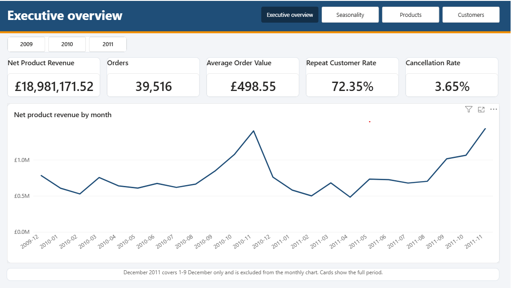
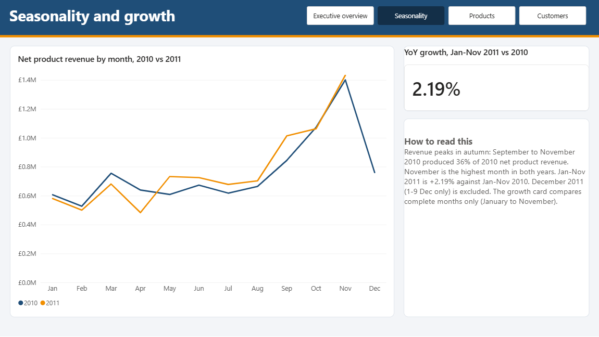
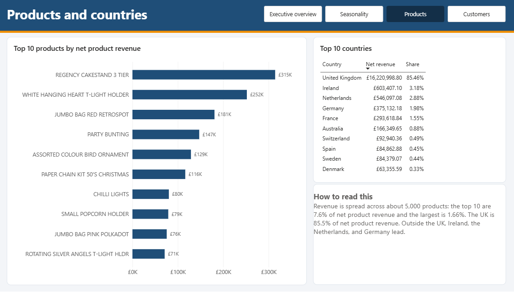
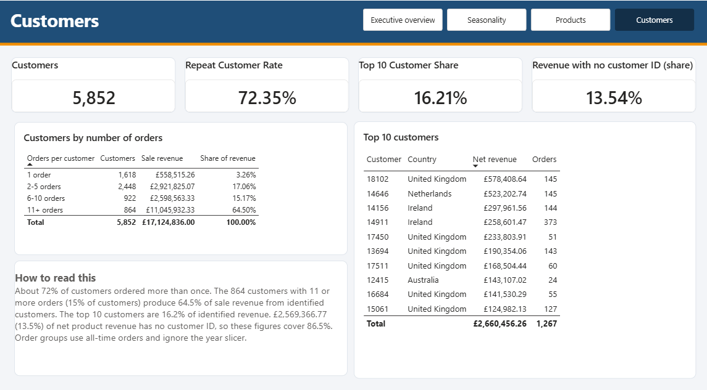

# E-Commerce Sales Analytics: Excel, Power Query, SQL, Power BI

An end-to-end analytics project on two years of real transactions from a UK online giftware retailer: from a raw two-sheet Excel file to a validated star schema and an interactive Power BI dashboard.
Every dashboard number was reproduced independently in MySQL (and key checks in Excel).



## Business problem

The retailer sells unique all-occasion giftware to individual shoppers and many wholesalers. It holds two years of sales data but cannot say when revenue peaks, which products and countries drive it, how dependent it is on a few customers, or how much cancellations cost. This project gives the commercial team a validated view to support inventory timing, marketing timing, and customer retention priorities.

## Objectives

1. **Time:** when does revenue peak, and how strong is the seasonality?
2. **Products:** which products drive revenue, and how concentrated is it?
3. **Customers:** how loyal are customers, and how dependent is revenue on the top accounts?
4. **Countries:** where does revenue come from, and how dependent is it on the UK?
5. **Cancellations:** how large are cancellations relative to sales?

Not in scope, because the data cannot support it: profit, delivery performance, satisfaction, product categories, wholesale versus retail.

## Dataset

Chen, D. (2019). *Online Retail II* [Dataset]. UCI Machine Learning Repository. https://doi.org/10.24432/C5CG6D
Licence: [CC BY 4.0](https://creativecommons.org/licenses/by/4.0/). 1,067,371 rows over two overlapping Excel sheets, 1 December 2009 to 9 December 2011, 8 columns.
**This project modifies the data** (overlap removed, rows classified, text cleaned, columns added). The raw data and `sales_clean.csv` are **not** included in this repository (see `data/raw/README.md`). The Power BI file embeds the cleaned data (about 17 MB) so the dashboard opens without a database; that embedded data is a modified adaptation shared under the same CC BY 4.0 terms.

## Tools

Excel (documentation, sample-based checks, PivotTable), Power Query, MySQL 8, Power BI Desktop, DAX, GitHub.

## Data pipeline

```
online_retail_II.xlsx (2 sheets, 1,067,371 rows)
  -> Power Query: remove 9-day overlap, set types, trim/standardize, classify rows (RowType)
  -> sales_clean.csv (1,044,848 rows)
  -> MySQL: staging table, flags (duplicates, quick reversals), star schema
  -> Power BI: relationships, date table, 27 DAX measures
  -> 4-page dashboard
```

## Data cleaning highlights

Nothing is deleted after the overlap: rows are **classified and flagged**, and each KPI chooses which types to include. The full log (18 rules and 4 tracked assumptions, each with Problem, Decision, Validation) is in `excel/Ecommerce_Documentation.xlsx`.

| Finding | Handling |
|---|---|
| The two sheets overlap for 1-9 Dec 2010 (22,523 lines, 1,088 invoices), identical at invoice level | Kept Sheet 2's copy |
| The table mixes sales with cancellations, postage, fees, bad-debt entries, stock write-offs, gift vouchers, and tests | `RowType`: Sale 1,015,074 / Cancellation 17,972 / StockAdjustment 5,914 / NonProductCharge 5,721 / GiftVoucher 100 / ZeroPriceItem 61 / AccountingEntry 6 |
| 11,812 exact duplicate rows (£54,228.42) | Flagged, not deleted |
| One sale of 80,995 units cancelled 12 minutes later (and 1,351 cancellations that reverse a sale within 24 hours) | Flagged as quick reversals |
| 173 stock codes in two letter cases; one with a trailing space | Upper-cased and trimmed |
| 43 country values (EIRE, RSA, USA, four non-countries) | `StandardCountry` and a `MapReady` flag |
| 22.5% of rows have no customer ID | Left NULL, never imputed |

A plain sum of quantity times price would have given £18,909,762.12, which is £71,409.40 below Net Product Revenue (£18,981,171.52).

## Data model

A star schema: `fact_sales` (one row per invoice line, 1,044,848 rows) with `dim_product` (5,131), `dim_customer` (5,942), `dim_country` (43), `dim_row_type` (7), and `dim_date` (built in DAX). All relationships are one-to-many with single-direction filtering. Details in the `Data_Model` and `Data_Dictionary` sheets.

## SQL analysis

Twelve numbered scripts in `sql/` (create, load, quality checks, flags, reconciliation, time, country, customer, product, KPI, model, patches). They use CTEs, window functions (`ROW_NUMBER`, `SUM() OVER`), conditional aggregation, and self-joins. Every script states the verified result in its comments.

## Power BI dashboard

Four pages: Executive overview, Seasonality, Products and countries, Customers. 27 DAX measures, documented and validated in `powerbi/dax_measures.md`.





## KPIs

| KPI | Definition | Value |
|---|---|---|
| Net Product Revenue | Sale + Cancellation rows | £18,981,171.52 |
| Orders | Distinct Sale invoices | 39,516 |
| Average Order Value | Gross Sales / orders | £498.55 (median £301.80) |
| Cancellation rate | Cancellations / Gross Sales | 3.65% |
| Repeat customer rate | Customers with 2+ orders | 72.35% |

## Key insights

Full detail (fact, interpretation, potential action) in `documentation/insights.md`.

1. Revenue peaks in autumn: September to November 2010 produced 36% of 2010 net product revenue; November is the top month in both years.
2. Growth is modest: January to November 2011 is +2.19% against 2010.
3. The typical order is about £300; a few large orders lift the mean to about £500.
4. The UK is 85.46% of net product revenue.
5. Revenue outside the UK is a few accounts: one customer is 95.8% of the Netherlands' identified revenue.
6. 864 customers with 11 or more orders (15%) produce 64.5% of identified sale revenue.
7. The top 10 products are 7.62% of net product revenue.

## Potential actions (suggestions, not conclusions)

Plan stock and marketing around September to November; treat the largest international accounts as key accounts; focus retention on customers with six or more orders; report the median order alongside the mean; ask how the two largest cancelled orders arose.

## Repository structure

```
README.md
data/        raw/ and cleaned/ (not included, see the READMEs inside)
excel/       Ecommerce_Documentation.xlsx (cleaning log, validation anchors, key results, data model, data dictionary)
power_query/ the Power Query pipeline (.pq files)
sql/         01 to 12 MySQL scripts
powerbi/     ecommerce_dashboard.pbix, DAX measures, theme files, page background
documentation/ insights.md, qa_review.md
screenshots/ dashboard pages
```

## How to reproduce

1. Download the dataset (see `data/raw/README.md`).
2. In Power Query, create the `SourceFilePath` parameter and the queries in `power_query/` (see its README), then export `Export_Sales` to `sales_clean.csv`.
3. In MySQL, run `sql/01` to `sql/12` in order (edit the file path in `02_load_data.sql`). Run the heavy queries (04, 07, 08, 09, 10, 11) from the `mysql` command-line client, because MySQL Workbench's default read timeout stops them.
4. In Power BI, connect to the `ecommerce` database, load `fact_sales` and the four dimensions, create the relationships, build `dim_date` and the measures from `powerbi/dax_measures.md`.
5. Compare your results with the verified numbers in each script and in the `Validation_Anchors` sheet.

## Limitations

- Two years of data cannot separate a trend from noise; December 2011 covers only 1-9 December.
- No cost, delivery, review, category, wholesale, or channel data.
- 13.5% of net product revenue has no customer ID, so customer measures cover 86.5% of revenue.
- Gross Sales and AOV include flagged duplicates and quick reversals (AOV is £490.51 without invoices containing a quick reversal).
- `Price` is treated as a unit price, verified on three products.
- Product names come from a rule (most frequent description among sale rows); 407 stock codes have no name.
- Assumptions: a 24-hour window for quick reversals, "Korea" means South Korea, discount lines excluded from product revenue.
- The SQL scripts were validated one by one but not rebuilt from an empty database in a single run.

## Future improvements

Cohort retention analysis, an ABC analysis of the product tail, wholesale segmentation (for example by order size), toggles for flagged rows, and a one-command rebuild.

## Credits and licence

Dataset: Chen, D. (2019), CC BY 4.0, modified as described above. Code: MIT (see `LICENSE`).
Author: Mohsin Tahseen | (https://www.linkedin.com/in/mohsin-tahseen/) | mohsintahseen2686@gmail.com
